# Nicmo

Public-transport trip planner for Medellín and the Aburrá Valley (Colombia), built with Flutter.

**[English](#english) · [Español](#español) · [Deutsch](#deutsch) · [中文](#中文)**

<p align="center">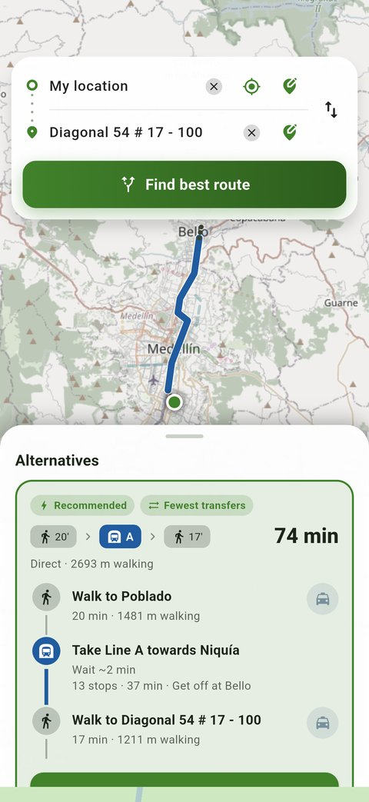 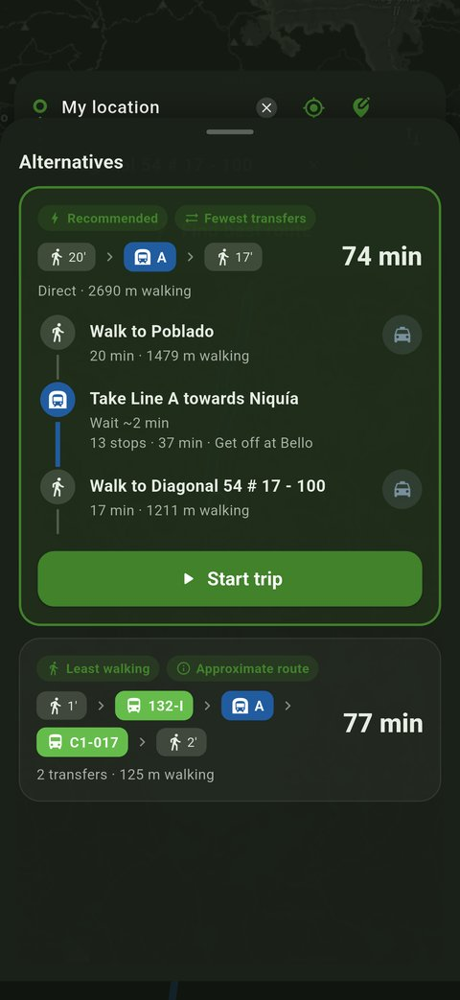 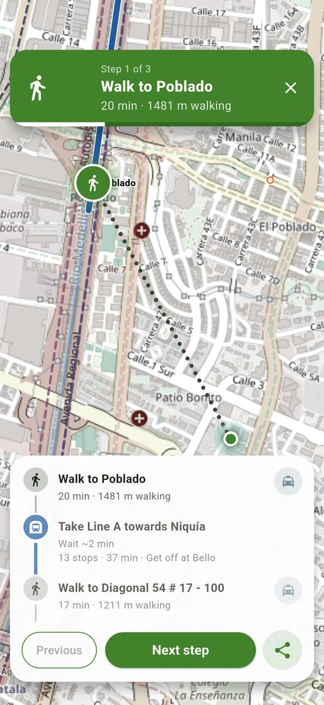 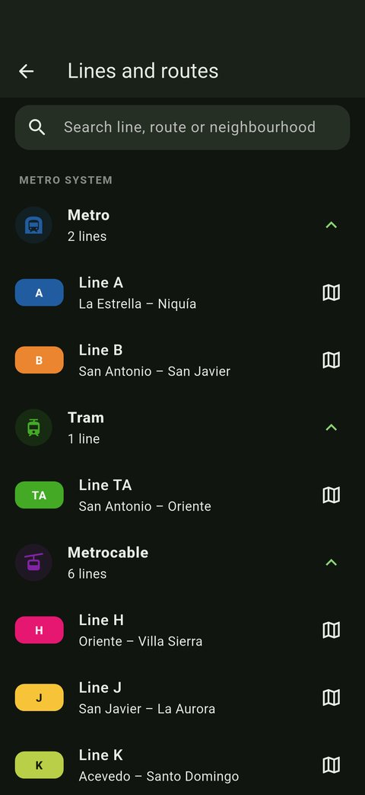</p>

---

## English

Nicmo is a public-transport trip planner for **Medellín and the Aburrá Valley** (Colombia), built with Flutter. It combines metro, tram, Metrocable, Metroplús, feeder and urban buses from official open data, and plans routes **on the phone**: no accounts, no backend of its own, and your searches are not stored.

### Features

- Search Colombian addresses ("Cra. 43B # 1A Sur - 70"), stations or places, or drop the points on the map.
- Best route plus alternatives: fastest, fewest transfers, least walking.
- Step-by-step guidance that survives closing the app or losing signal.
- Swap a walking leg for a car ride (Uber or inDrive) and share your trip.
- Every line and route of the network, searchable and shown on the map.
- OpenStreetMap map with no API key, light and dark themes, in English, Spanish, German and Chinese.

### How to use it

**1. Welcome.** Four short steps introduce the app. The last one picks the city (Medellín) and links the terms and conditions; tap **Get started** to accept them and open the map. **Skip** jumps straight to the city step.

<p>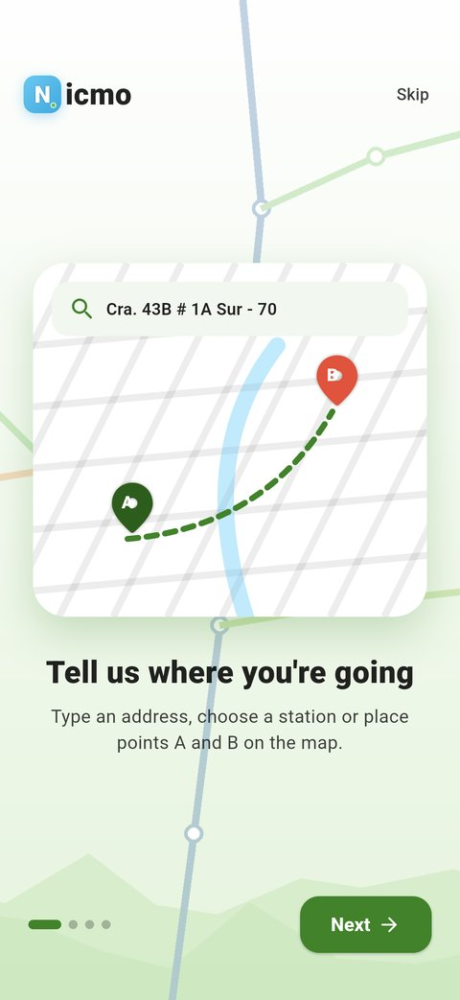 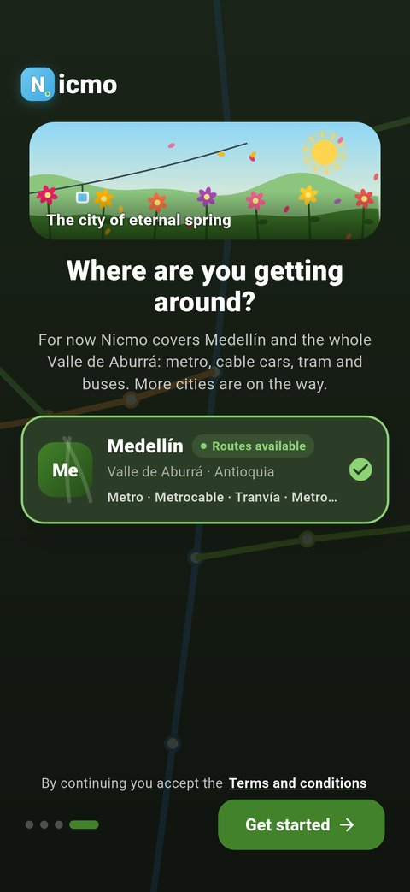</p>

**2. The map.** The ☰ menu opens **Map**, **Lines and routes**, **Settings** and the light/dark switch. **All transport** chooses which systems are drawn (metro, cable cars, buses…). The ◎ button centres the map on you.

<p>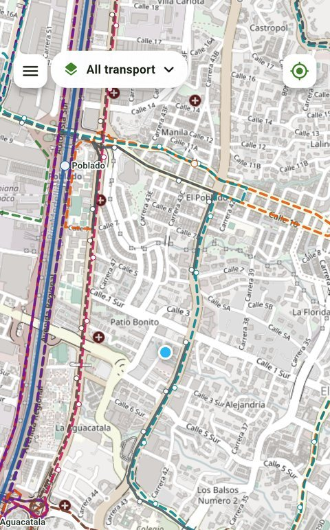</p>

**3. Plan a trip.** In **Starting point** tap ◎ (**My location**), type an address, station or place, or use the pin button to **place the point on the map**. Do the same in **Where are you going?** (⇅ swaps both) and tap **Find best route**.

<p></p>

**4. Pick an alternative.** Each card shows its tags (**Recommended**, **Fewest transfers**, **Least walking**), the total time and every leg: walks, waits, stops and where to get off. The car button on a walking leg turns it into an Uber or inDrive ride. Then tap **Start trip**.

<p></p>

**5. Follow the trip.** The top card shows the current step ("Step 1 of 3"); move with **Previous** and **Next step**. The share button sends a Google Maps link with where you are. ✕ ends the trip. If you close the app, the trip is still there when you come back, even offline.

<p></p>

**6. Lines and routes.** From the menu, search any line, route or neighbourhood and open it on the map. Buses show their stops and the municipalities they cross.

<p></p>

**7. Settings.** Dark mode, language (or the phone's), notifications, and the terms and conditions.

<p>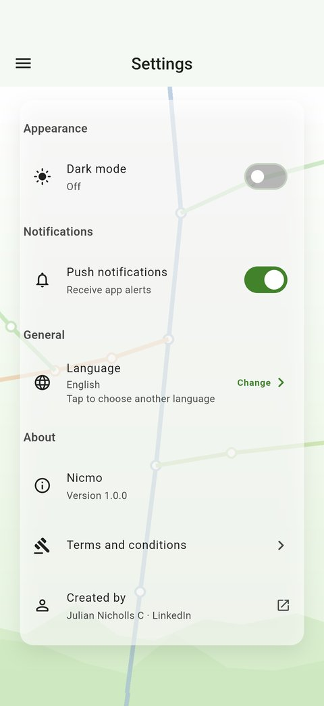</p>

### Getting started

Requires Flutter 3.41 (Dart 3.11) or newer.

```bash
flutter pub get
flutter run                 # Android, iOS or web
flutter build web           # web build in build/web
```

Ads (Google AdMob) are optional. Debug builds always use Google's test ads; release builds without unit IDs request none. To use your own, copy `env/ads.example.json` to `env/ads.json` (gitignored), add your ad unit IDs and build with `--dart-define-from-file=env/ads.json`. If you publish your own build, also change the AdMob App ID in `android/app/src/main/AndroidManifest.xml` and `ios/Runner/Info.plist`, and the `com.jnicholls.nicmo` application id.

### How it is built

| Layer | Where |
|---|---|
| Domain | `lib/domain/city/` (cities and catalog), `lib/domain/transit/` (network, lines, itineraries) |
| Infrastructure | `lib/infrastructure/transit/` (per-city network and `MultimodalTripPlanner`), `geocoding/` (Nominatim and Colombian addresses), `map/` (OpenFreeMap styles and offline tiles) |
| State | Global `ValueNotifier`s in `lib/state/` (city, trip, location, filters, theme, language) |
| UI | `lib/screens/` and `lib/widget/`; go_router routes in `lib/routes/` |

- **Cities.** The catalog is `assets/cities/cities.json`. Each city's network lives in `assets/cities/<city>/{metro,buses,urban}.json`, with geometry as encoded polylines. Only the current city is loaded. Medellín is the only active one; the rest sit behind `kMultiCityEnabled` (`lib/app_info.dart`).
- **Planner.** A graph with one street node per station and one on-board node per line; street buses can be boarded or left anywhere along their path. Details in [`docs/metro_trip_planner.md`](docs/metro_trip_planner.md).
- **No backend.** Everything runs on the device. Searches go to Nominatim (OpenStreetMap) and map tiles come from OpenFreeMap.

### Data

Every line comes from a cited open source; no Moovit, Google or private data is used. The Python 3 tools in `tool/` import it:

- `import_metro_open_data.py`: Metro de Medellín open data (feeders, GTFS) → `buses` layer.
- `build_bus_routes.py`, `build_metropolitan_routes.py`, `import_urban_buses.py`: Medellín Secretaría de Movilidad routes and metropolitan routes → `urban` layer.

Sources, coverage and gaps: [`docs/rutas_buses_valle_aburra_2026.md`](docs/rutas_buses_valle_aburra_2026.md). Adding cities: [`docs/escalabilidad_ciudades.md`](docs/escalabilidad_ciudades.md) (the docs are in Spanish).

### Tests

```bash
flutter analyze
flutter test                                          # unit and widget tests
flutter test test/polyline_test.dart --platform chrome
```

The screenshots are taken on a real phone by an integration test (origin: the phone's location; destination: Diagonal 54 # 17 - 100). One run covers English and Spanish, light and dark; the PNGs land in `docs/screenshots/<lang>/` (three candidates per welcome screen) and the README uses a selection as 480 px JPEGs.

```bash
flutter drive -d <device> \
  --driver=test_driver/integration_test.dart \
  --target=integration_test/screenshots_test.dart
```

### Contributing

- Never invent routes: every new line must come from an open source cited in its layer's `sources` field.
- UI strings go in `lib/il8n/app_*.arb` (template `app_en.arb`), then run `flutter gen-l10n`.
- The UI must not overflow on 360 dp phones or with large text.
- Run `dart format lib test` and keep `flutter analyze` clean before opening a pull request.

### License

The code is licensed under [Apache 2.0](LICENSE). The data in `assets/cities/` is **not** covered by it and keeps its source's license: ODbL for OpenStreetMap, CC BY-SA 4.0 for Metro de Medellín and the Medellín city government; the Itagüí geoportal routes are public information with no declared open license. See [`NOTICE`](NOTICE).

Nicmo is not affiliated with Metro de Medellín, the Área Metropolitana del Valle de Aburrá, or any city government or transport company.

---

## Español

Nicmo es un planificador de viajes en transporte público para **Medellín y el Valle de Aburrá** (Colombia), hecho en Flutter. Combina metro, tranvía, Metrocable, Metroplús, alimentadores y buses urbanos con datos abiertos oficiales y calcula las rutas **en el teléfono**: no hay cuentas ni servidor propio, y tus búsquedas no se guardan.

### Qué hace

- Busca direcciones colombianas («Cra. 43B # 1A Sur - 70»), estaciones o lugares, o marca los puntos en el mapa.
- Propone la mejor ruta y alternativas: más rápida, menos transbordos, menos caminata.
- Guía el viaje paso a paso y lo recuerda si cierras la app o pierdes la señal.
- Cambia un tramo a pie por un carro (Uber o inDrive) y comparte tu viaje.
- Todas las líneas y rutas de la red, con buscador y vista en el mapa.
- Mapa de OpenStreetMap sin API key, tema claro y oscuro, en español, inglés, alemán y chino.

### Cómo se usa

**1. Bienvenida.** Cuatro pasos cortos presentan la app. El último elige la ciudad (Medellín) y enlaza los términos y condiciones; toca **Comenzar** para aceptarlos y abrir el mapa. **Omitir** salta directo a la ciudad.

<p>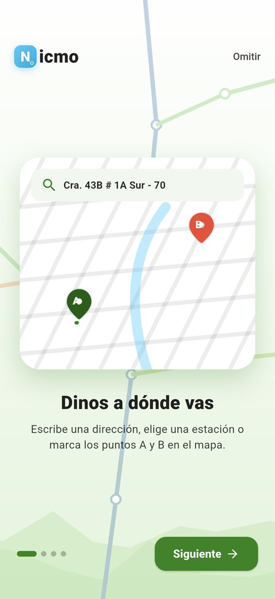 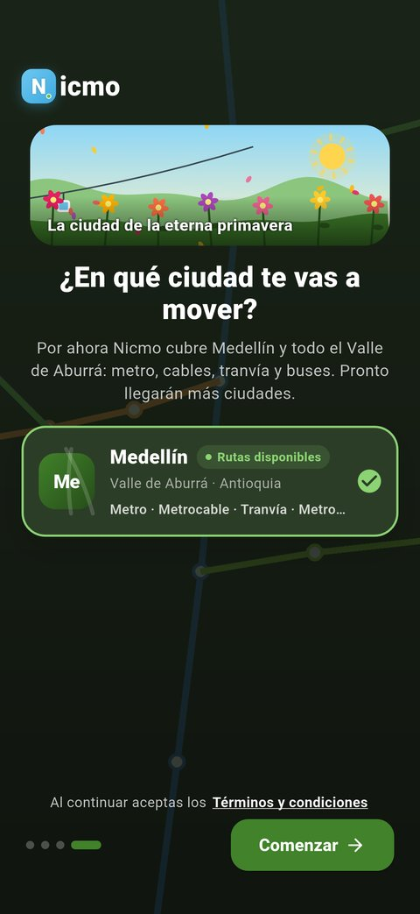</p>

**2. El mapa.** El menú ☰ abre **Mapa**, **Líneas y rutas**, **Configuración** y el cambio de tema claro/oscuro. **Todo el transporte** elige qué sistemas se dibujan (metro, cables, buses…). El botón ◎ centra el mapa en ti.

<p>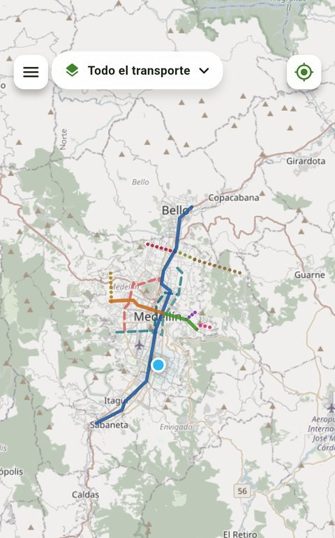</p>

**3. Planear un viaje.** En **Punto de partida** toca ◎ (**Mi ubicación**), escribe una dirección, estación o lugar, o usa el botón del pin para **marcar el punto en el mapa**. Haz lo mismo en **¿A dónde vas?** (⇅ los intercambia) y toca **Buscar mejor ruta**.

<p>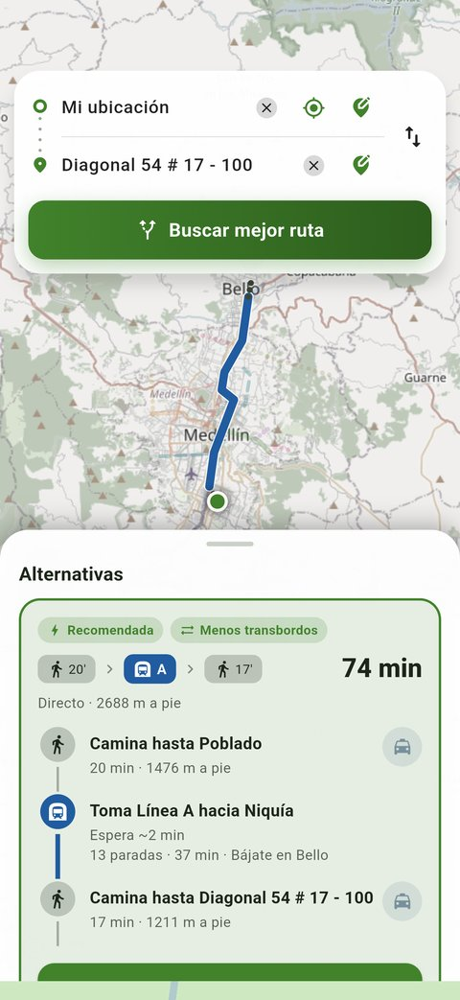</p>

**4. Elegir una alternativa.** Cada tarjeta muestra sus etiquetas (**Recomendada**, **Menos transbordos**, **Menos caminata**), el tiempo total y cada tramo: caminatas, esperas, paradas y dónde bajarte. El botón del carro en un tramo a pie lo cambia por un viaje en Uber o inDrive. Luego toca **Comenzar viaje**.

<p>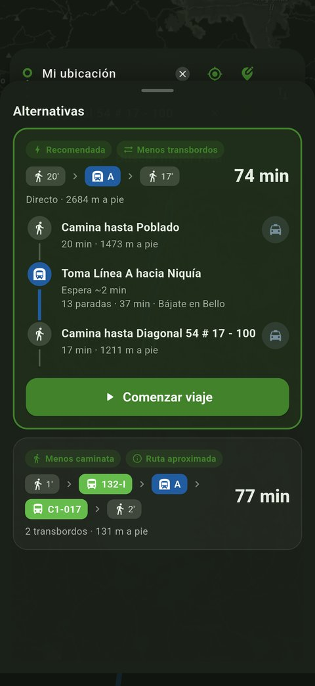</p>

**5. Seguir el viaje.** La tarjeta de arriba muestra el paso actual («Paso 1 de 3»); avanza con **Anterior** y **Siguiente paso**. El botón de compartir envía un enlace de Google Maps con el punto donde estás. ✕ termina el viaje. Si cierras la app, el viaje sigue ahí al volver, incluso sin conexión.

<p>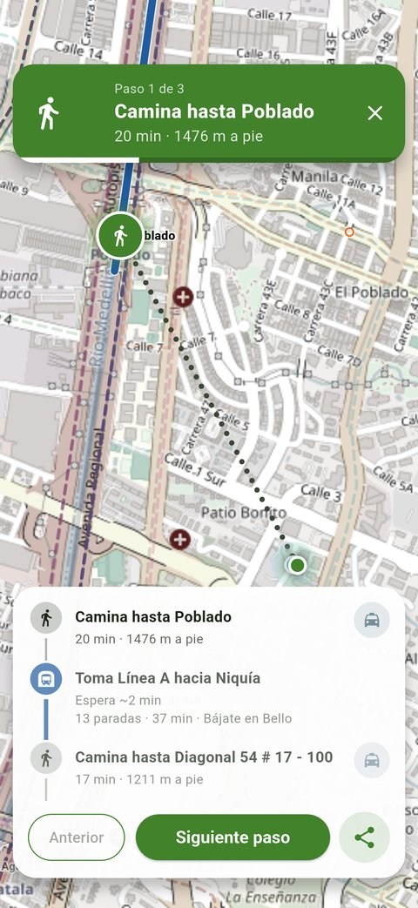</p>

**6. Líneas y rutas.** Desde el menú, busca cualquier línea, ruta o barrio y ábrela en el mapa. Los buses muestran sus paraderos y los municipios por los que pasan.

<p>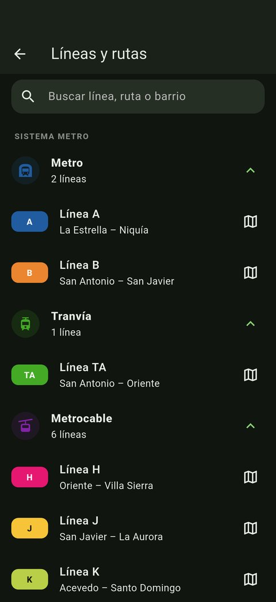</p>

**7. Configuración.** Modo oscuro, idioma (o el del teléfono), notificaciones y los términos y condiciones.

<p>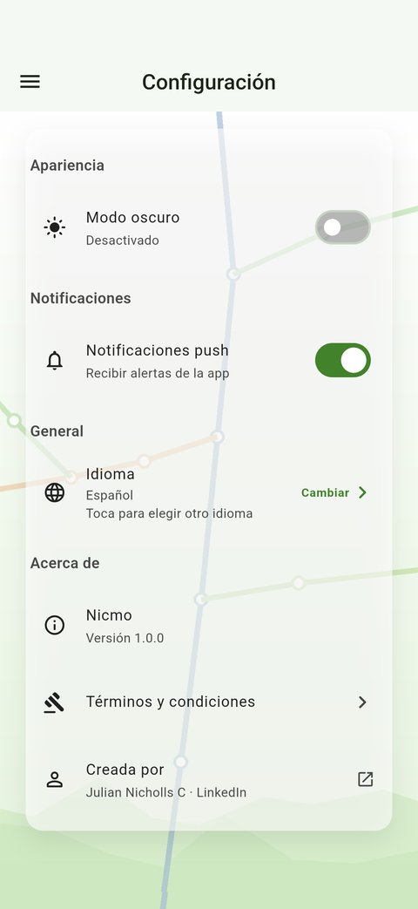</p>

### Empezar

Requisitos: Flutter 3.41 (Dart 3.11) o superior.

```bash
flutter pub get
flutter run                 # Android, iOS o web
flutter build web           # versión web en build/web
```

Los anuncios (Google AdMob) son opcionales. En debug siempre se usan los anuncios de prueba de Google; en release sin IDs no se pide ninguno. Para usar los tuyos, copia `env/ads.example.json` a `env/ads.json` (está en `.gitignore`), pon tus IDs de bloque y compila con `--dart-define-from-file=env/ads.json`. Si publicas tu propia versión, cambia también el App ID de AdMob en `android/app/src/main/AndroidManifest.xml` y `ios/Runner/Info.plist`, y el identificador `com.jnicholls.nicmo`.

### Cómo está hecho

| Capa | Dónde |
|---|---|
| Dominio | `lib/domain/city/` (ciudades y catálogo), `lib/domain/transit/` (red, líneas, itinerarios) |
| Infraestructura | `lib/infrastructure/transit/` (red por ciudad y `MultimodalTripPlanner`), `geocoding/` (Nominatim y direcciones colombianas), `map/` (estilos de OpenFreeMap y teselas sin conexión) |
| Estado | `ValueNotifier` globales en `lib/state/` (ciudad, viaje, ubicación, filtros, tema, idioma) |
| Interfaz | `lib/screens/` y `lib/widget/`; rutas con go_router en `lib/routes/` |

- **Ciudades.** El catálogo está en `assets/cities/cities.json`. La red de cada ciudad vive en `assets/cities/<ciudad>/{metro,buses,urban}.json`, con la geometría como polilíneas codificadas. Solo se carga la ciudad actual. Medellín es la única activa; las demás quedan detrás de `kMultiCityEnabled` (`lib/app_info.dart`).
- **Planificador.** Un grafo con un nodo de calle por estación y uno «a bordo» por línea; los buses de calle se pueden tomar o dejar en cualquier punto de su recorrido. Detalle en [`docs/metro_trip_planner.md`](docs/metro_trip_planner.md).
- **Sin backend.** Todo corre en el dispositivo. Las búsquedas van a Nominatim (OpenStreetMap) y el mapa se descarga de OpenFreeMap.

### Datos

Cada línea sale de una fuente abierta y citada; no se usan datos de Moovit, Google ni fuentes privadas. Las herramientas de `tool/` (Python 3) los importan:

- `import_metro_open_data.py`: datos abiertos del Metro de Medellín (alimentadores, GTFS) → capa `buses`.
- `build_bus_routes.py`, `build_metropolitan_routes.py`, `import_urban_buses.py`: rutas de la Secretaría de Movilidad de Medellín y rutas metropolitanas → capa `urban`.

Fuentes, cobertura y vacíos: [`docs/rutas_buses_valle_aburra_2026.md`](docs/rutas_buses_valle_aburra_2026.md). Cómo agregar ciudades: [`docs/escalabilidad_ciudades.md`](docs/escalabilidad_ciudades.md).

### Pruebas

```bash
flutter analyze
flutter test                                          # pruebas unitarias y de widgets
flutter test test/polyline_test.dart --platform chrome
```

Las capturas se toman en un teléfono real con una prueba de integración (origen: la ubicación del teléfono; destino: Diagonal 54 # 17 - 100). Una corrida cubre inglés y español, claro y oscuro; los PNG quedan en `docs/screenshots/<idioma>/` (tres candidatas por pantalla de bienvenida) y el README usa una selección como JPEG de 480 px.

```bash
flutter drive -d <dispositivo> \
  --driver=test_driver/integration_test.dart \
  --target=integration_test/screenshots_test.dart
```

### Contribuir

- Nunca inventes rutas: cada línea nueva debe venir de una fuente abierta citada en el campo `sources` de su capa.
- Los textos de la interfaz van en `lib/il8n/app_*.arb` (plantilla `app_en.arb`); luego `flutter gen-l10n`.
- La interfaz no debe desbordarse en teléfonos de 360 dp ni con texto grande.
- `dart format lib test` y `flutter analyze` sin errores antes de abrir un pull request.

### Licencia

El código está bajo la licencia [Apache 2.0](LICENSE). Los datos de `assets/cities/` **no** están cubiertos por esa licencia y conservan la de su fuente: ODbL para OpenStreetMap, CC BY-SA 4.0 para el Metro y la Alcaldía de Medellín; las rutas del geoportal de Itagüí son información pública sin licencia abierta declarada. Ver [`NOTICE`](NOTICE).

Nicmo no está afiliado al Metro de Medellín, al Área Metropolitana del Valle de Aburrá ni a ninguna alcaldía o empresa de transporte.

---

## Deutsch

Nicmo ist ein Reiseplaner für den öffentlichen Nahverkehr in **Medellín und dem Aburrá-Tal** (Kolumbien), entwickelt mit Flutter. Er kombiniert Metro, Straßenbahn, Metrocable, Metroplús, Zubringer- und Stadtbusse aus offiziellen offenen Daten und berechnet die Routen **auf dem Handy**: keine Konten, kein eigener Server, und deine Suchen werden nicht gespeichert.

### Funktionen

- Kolumbianische Adressen ("Cra. 43B # 1A Sur - 70"), Stationen oder Orte suchen oder die Punkte auf der Karte setzen.
- Beste Route plus Alternativen: am schnellsten, wenigste Umstiege, wenigster Fußweg.
- Schritt-für-Schritt-Führung, die das Schließen der App und Funklöcher übersteht.
- Einen Fußweg durch eine Autofahrt (Uber oder inDrive) ersetzen und die Fahrt teilen.
- Alle Linien und Routen des Netzes, durchsuchbar und auf der Karte.
- OpenStreetMap-Karte ohne API-Schlüssel, helles und dunkles Design, auf Englisch, Spanisch, Deutsch und Chinesisch.

### So funktioniert es

**1. Willkommen.** Vier kurze Schritte stellen die App vor. Der letzte wählt die Stadt (Medellín) und verlinkt die Nutzungsbedingungen; tippe auf **Los geht's**, um sie zu akzeptieren und die Karte zu öffnen. **Überspringen** führt direkt zur Stadtauswahl.

<p> </p>

**2. Die Karte.** Das Menü ☰ öffnet **Karte**, **Linien und Routen**, **Einstellungen** und den Hell/Dunkel-Schalter. **Alle Verkehrsmittel** wählt, welche Systeme gezeichnet werden (Metro, Seilbahnen, Busse…). Die Taste ◎ zentriert die Karte auf dich.

<p></p>

**3. Fahrt planen.** Tippe bei **Startpunkt** auf ◎ (**Mein Standort**), gib eine Adresse, Station oder einen Ort ein oder nutze die Pin-Taste, um den **Punkt auf der Karte zu setzen**. Genauso bei **Wohin möchtest du?** (⇅ tauscht beide), dann **Beste Route suchen**.

<p></p>

**4. Alternative wählen.** Jede Karte zeigt ihre Merkmale (**Empfohlen**, **Wenigste Umstiege**, **Wenigster Fußweg**), die Gesamtzeit und jede Etappe: Fußwege, Wartezeiten, Haltestellen und wo du aussteigst. Die Auto-Taste bei einem Fußweg macht daraus eine Fahrt mit Uber oder inDrive. Dann **Fahrt starten**.

<p></p>

**5. Der Fahrt folgen.** Die obere Karte zeigt den aktuellen Schritt ("Schritt 1 von 3"); weiter mit **Zurück** und **Nächster Schritt**. Die Teilen-Taste sendet einen Google-Maps-Link mit deinem Standort. ✕ beendet die Fahrt. Schließt du die App, ist die Fahrt beim Zurückkommen noch da, auch offline.

<p></p>

**6. Linien und Routen.** Über das Menü jede Linie, Route oder jedes Viertel suchen und auf der Karte öffnen. Busse zeigen ihre Haltestellen und die Gemeinden, durch die sie fahren.

<p></p>

**7. Einstellungen.** Dunkelmodus, Sprache (oder die des Handys), Benachrichtigungen und die Nutzungsbedingungen.

<p></p>

### Loslegen

Voraussetzung: Flutter 3.41 (Dart 3.11) oder neuer.

```bash
flutter pub get
flutter run                 # Android, iOS oder Web
flutter build web           # Web-Version in build/web
```

Werbung (Google AdMob) ist optional. Debug-Builds nutzen immer die Testanzeigen von Google; Release-Builds ohne Anzeigenblock-IDs fordern keine an. Für eigene Anzeigen kopiere `env/ads.example.json` nach `env/ads.json` (in `.gitignore`), trage deine IDs ein und baue mit `--dart-define-from-file=env/ads.json`. Wenn du eine eigene Version veröffentlichst, ändere auch die AdMob-App-ID in `android/app/src/main/AndroidManifest.xml` und `ios/Runner/Info.plist` sowie die Kennung `com.jnicholls.nicmo`.

### Aufbau

| Schicht | Wo |
|---|---|
| Domäne | `lib/domain/city/` (Städte und Katalog), `lib/domain/transit/` (Netz, Linien, Reiserouten) |
| Infrastruktur | `lib/infrastructure/transit/` (Netz pro Stadt und `MultimodalTripPlanner`), `geocoding/` (Nominatim und kolumbianische Adressen), `map/` (OpenFreeMap-Stile und Offline-Kacheln) |
| Zustand | Globale `ValueNotifier` in `lib/state/` (Stadt, Fahrt, Standort, Filter, Design, Sprache) |
| Oberfläche | `lib/screens/` und `lib/widget/`; go_router-Routen in `lib/routes/` |

- **Städte.** Der Katalog ist `assets/cities/cities.json`. Das Netz jeder Stadt liegt in `assets/cities/<stadt>/{metro,buses,urban}.json`, die Geometrie als kodierte Polylinien. Nur die aktuelle Stadt wird geladen. Medellín ist als einzige aktiv; die übrigen stehen hinter `kMultiCityEnabled` (`lib/app_info.dart`).
- **Planer.** Ein Graph mit einem Straßenknoten pro Station und einem "An Bord"-Knoten pro Linie; Straßenbusse kann man an jedem Punkt ihrer Strecke nehmen oder verlassen. Details in [`docs/metro_trip_planner.md`](docs/metro_trip_planner.md).
- **Kein Backend.** Alles läuft auf dem Gerät. Suchen gehen an Nominatim (OpenStreetMap), Kartenkacheln kommen von OpenFreeMap.

### Daten

Jede Linie stammt aus einer zitierten offenen Quelle; Daten von Moovit, Google oder private Quellen werden nicht verwendet. Die Python-3-Werkzeuge in `tool/` importieren sie:

- `import_metro_open_data.py`: offene Daten der Metro de Medellín (Zubringer, GTFS) → Ebene `buses`.
- `build_bus_routes.py`, `build_metropolitan_routes.py`, `import_urban_buses.py`: Routen der Secretaría de Movilidad de Medellín und Metropolrouten → Ebene `urban`.

Quellen, Abdeckung und Lücken: [`docs/rutas_buses_valle_aburra_2026.md`](docs/rutas_buses_valle_aburra_2026.md). Städte hinzufügen: [`docs/escalabilidad_ciudades.md`](docs/escalabilidad_ciudades.md) (die Dokumentation ist auf Spanisch).

### Tests

```bash
flutter analyze
flutter test                                          # Unit- und Widget-Tests
flutter test test/polyline_test.dart --platform chrome
```

Die Screenshots entstehen auf einem echten Handy durch einen Integrationstest (Start: Standort des Handys; Ziel: Diagonal 54 # 17 - 100). Ein Lauf deckt Englisch und Spanisch, hell und dunkel ab; die PNGs landen in `docs/screenshots/<sprache>/` (drei Kandidaten pro Willkommensbildschirm), das README nutzt eine Auswahl als 480-px-JPEGs.

```bash
flutter drive -d <gerät> \
  --driver=test_driver/integration_test.dart \
  --target=integration_test/screenshots_test.dart
```

### Mitmachen

- Nie Routen erfinden: jede neue Linie braucht eine offene Quelle im Feld `sources` ihrer Ebene.
- Texte der Oberfläche gehören in `lib/il8n/app_*.arb` (Vorlage `app_en.arb`), danach `flutter gen-l10n`.
- Die Oberfläche darf auf 360-dp-Handys und mit großer Schrift nicht überlaufen.
- Vor einem Pull Request `dart format lib test` ausführen und `flutter analyze` sauber halten.

### Lizenz

Der Code steht unter der [Apache-2.0-Lizenz](LICENSE). Die Daten in `assets/cities/` fallen **nicht** darunter und behalten die Lizenz ihrer Quelle: ODbL für OpenStreetMap, CC BY-SA 4.0 für die Metro und die Stadtverwaltung von Medellín; die Routen aus dem Geoportal von Itagüí sind öffentliche Informationen ohne erklärte offene Lizenz. Siehe [`NOTICE`](NOTICE).

Nicmo ist nicht mit der Metro de Medellín, dem Área Metropolitana del Valle de Aburrá oder einer Stadtverwaltung oder einem Verkehrsunternehmen verbunden.

---

## 中文

Nicmo 是一款用 Flutter 开发的公共交通出行规划应用，覆盖 **麦德林及阿布拉谷地区**（哥伦比亚）。它基于官方开放数据，组合地铁、有轨电车、缆车（Metrocable）、Metroplús、接驳巴士和城市公交，并**在手机上**计算路线：无需账号，没有自己的服务器，也不保存你的搜索记录。

### 功能

- 搜索哥伦比亚地址（"Cra. 43B # 1A Sur - 70"）、车站或地点，或直接在地图上标记。
- 提供最佳路线和备选路线：最快、换乘最少、步行最少。
- 逐步导航，关闭应用或信号中断后行程依然保留。
- 可将步行路段改为打车（Uber 或 inDrive），并分享行程。
- 可搜索网络中的所有线路，并在地图上查看。
- 无需 API 密钥的 OpenStreetMap 地图，浅色和深色主题，支持英语、西班牙语、德语和中文。

### 使用指南

**1. 欢迎页.** 四个简短步骤介绍应用。最后一步选择城市（麦德林）并附上条款与条件链接；点击 **开始使用** 即表示接受并进入地图。**跳过** 会直接进入城市选择。

<p> </p>

**2. 地图.** ☰ 菜单包含 **地图**、**线路**、**设置** 以及浅色/深色切换。**全部交通** 用于选择在地图上显示哪些系统（地铁、缆车、公交……）。◎ 按钮将地图定位到你所在的位置。

<p></p>

**3. 规划行程.** 在 **出发地** 中点击 ◎（**我的位置**），输入地址、车站或地点，或用图钉按钮 **在地图上标记位置**。在 **你要去哪里？** 中同样操作（⇅ 可交换两者），然后点击 **查找最佳路线**。

<p></p>

**4. 选择路线.** 每张卡片显示标签（**推荐**、**换乘最少**、**步行最少**）、总时间以及每一段：步行、等待、站数和下车地点。步行路段上的汽车按钮可将其改为 Uber 或 inDrive 打车。然后点击 **开始行程**。

<p></p>

**5. 跟随行程.** 顶部卡片显示当前步骤（"第 1 步，共 3 步"）；用 **上一步** 和 **下一步** 切换。分享按钮会发送带有你当前位置的 Google 地图链接。✕ 结束行程。即使关闭应用或离线，返回时行程仍在。

<p></p>

**6. 线路.** 从菜单中搜索任意线路、路线或街区，并在地图上打开。公交线路会显示站点和途经的市镇。

<p></p>

**7. 设置.** 深色模式、语言（或跟随手机）、通知以及条款与条件。

<p></p>

### 快速开始

需要 Flutter 3.41（Dart 3.11）或更高版本。

```bash
flutter pub get
flutter run                 # Android、iOS 或 Web
flutter build web           # Web 版本输出到 build/web
```

广告（Google AdMob）是可选的。Debug 构建始终使用 Google 的测试广告；未配置广告单元 ID 的 Release 构建不会请求广告。如需使用自己的广告，将 `env/ads.example.json` 复制为 `env/ads.json`（已在 `.gitignore` 中），填入你的广告单元 ID，并使用 `--dart-define-from-file=env/ads.json` 构建。如果发布自己的版本，还需修改 `android/app/src/main/AndroidManifest.xml` 和 `ios/Runner/Info.plist` 中的 AdMob 应用 ID，以及应用标识 `com.jnicholls.nicmo`。

### 项目结构

| 层 | 位置 |
|---|---|
| 领域 | `lib/domain/city/`（城市与目录），`lib/domain/transit/`（网络、线路、行程） |
| 基础设施 | `lib/infrastructure/transit/`（按城市加载的网络与 `MultimodalTripPlanner`），`geocoding/`（Nominatim 与哥伦比亚地址），`map/`（OpenFreeMap 样式与离线瓦片） |
| 状态 | `lib/state/` 中的全局 `ValueNotifier`（城市、行程、位置、筛选、主题、语言） |
| 界面 | `lib/screens/` 和 `lib/widget/`；go_router 路由位于 `lib/routes/` |

- **城市。** 目录文件为 `assets/cities/cities.json`。每个城市的网络位于 `assets/cities/<城市>/{metro,buses,urban}.json`，几何数据为编码折线。只加载当前城市。目前只有麦德林启用，其余城市由 `kMultiCityEnabled`（`lib/app_info.dart`）控制。
- **规划器。** 图中每个车站有一个街道节点，每条线路有一个"车上"节点；街道公交可在线路上任意位置上下车。详见 [`docs/metro_trip_planner.md`](docs/metro_trip_planner.md)。
- **无后端。** 一切都在设备上运行。搜索发送到 Nominatim（OpenStreetMap），地图瓦片来自 OpenFreeMap。

### 数据

每条线路都来自注明出处的开放数据源；不使用 Moovit、Google 或私有数据。`tool/` 中的 Python 3 工具负责导入：

- `import_metro_open_data.py`：麦德林地铁开放数据（接驳线、GTFS）→ `buses` 图层。
- `build_bus_routes.py`、`build_metropolitan_routes.py`、`import_urban_buses.py`：麦德林交通局路线和都市区路线 → `urban` 图层。

数据来源、覆盖范围和缺口：[`docs/rutas_buses_valle_aburra_2026.md`](docs/rutas_buses_valle_aburra_2026.md)。添加城市：[`docs/escalabilidad_ciudades.md`](docs/escalabilidad_ciudades.md)（文档为西班牙语）。

### 测试

```bash
flutter analyze
flutter test                                          # 单元测试和组件测试
flutter test test/polyline_test.dart --platform chrome
```

截图由集成测试在真机上自动拍摄（起点：手机当前位置；终点：Diagonal 54 # 17 - 100）。一次运行即可覆盖英语和西班牙语、浅色和深色主题；PNG 保存在 `docs/screenshots/<语言>/`（每个欢迎页有三张候选图），README 选用其中一部分并转为 480 px 的 JPEG。

```bash
flutter drive -d <设备> \
  --driver=test_driver/integration_test.dart \
  --target=integration_test/screenshots_test.dart
```

### 参与贡献

- 切勿编造路线：每条新线路都必须来自开放数据源，并写入其图层的 `sources` 字段。
- 界面文字放在 `lib/il8n/app_*.arb`（模板为 `app_en.arb`），然后运行 `flutter gen-l10n`。
- 界面在 360 dp 宽的手机和大字体下不得溢出。
- 提交 Pull Request 前运行 `dart format lib test`，并保证 `flutter analyze` 无错误。

### 许可证

代码采用 [Apache 2.0](LICENSE) 许可证。`assets/cities/` 中的数据**不**适用该许可证，保留其来源的许可：OpenStreetMap 为 ODbL，麦德林地铁和麦德林市政府数据为 CC BY-SA 4.0；伊塔圭（Itagüí）地理门户的路线为公开信息，未声明开放许可。详见 [`NOTICE`](NOTICE)。

Nicmo 与麦德林地铁、阿布拉谷都市区（Área Metropolitana del Valle de Aburrá）以及任何市政府或交通公司均无关联。
